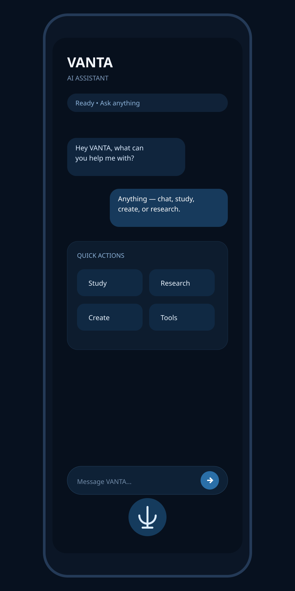

# VANTA — Android AI Assistant

VANTA is a clean, tool-ready Android AI assistant built with Kotlin + Jetpack Compose.

## UI Preview

The preview shows the intended clean dark-blue VANTA interface: unified chat, quick actions, research, create/study tools, and voice input.

## Design

Figma design: https://www.figma.com/design/RNHcFGcabFoaw7oti4thYv

## Build

GitHub Actions builds a debug APK automatically on pushes to main or manual workflow dispatch.
